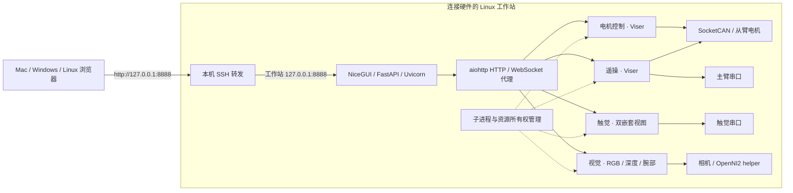

# 库与统一平台架构

适用版本：**v0.6.0**。项目既是可供 Python 程序导入的库，也是一个通过浏览器操作的本地工作台。日常使用只需启动统一入口；各模块仍保留独立 CLI，供开发和诊断使用。

[返回首页](Home.md) · [Python API](Python-API.md) · [常用命令](CLI-Reference.md)

## 一个浏览器地址

在工作站本机浏览时直接访问平台，不需要 SSH。异地浏览只转发 8888，包括视频图像、Viser WebSocket 及两个嵌套触觉视图。Mac 和 Windows 不承担 Linux CAN 控制；它们作为终端和浏览器客户端。详见[远程访问](Remote-Access.md)。

## 使用的框架

| 组件 | 职责 |
| --- | --- |
| NiceGUI 3.18.0 | 导航、状态、确认对话框和模块工作区 |
| FastAPI / Uvicorn | 平台 ASGI 应用、HTTP 服务与生命周期 |
| aiohttp 3.14.5 | 复用上游连接，代理 HTTP、流式图像和 WebSocket |
| Viser | 机器人姿态、电机控制、遥操和触觉 3D 页面 |
| Flask | 独立视觉模块的网页和帧接口 |
| ServiceManager | 按外部配置启动子进程，区分自有与外部进程，串行切换控制模式 |

成熟框架承担网络连接和界面事件；硬件控制、设备租约、退出失能仍由各模块维护。网页切到触觉或视觉时会保留已打开模块的视图和连接。电机控制与遥操是互斥模式，切换时先正常停止当前自有服务，再启动另一模式。

## 默认端口与页面

| 用途 | 默认工作站端口 | 统一入口路径 |
| --- | --- | --- |
| 平台入口 | 8888 | `/` |
| 电机控制 | 8893 | `/apps/control/` |
| 遥操 | 8890 | `/apps/teleop/` |
| 触觉主页面 | 8891 | `/apps/tactile/` |
| 两个触觉内部视图 | 8901、8902 | 由触觉页面经平台加载 |
| 视觉 | 5003 | `/apps/vision/` |

子服务在内部仍使用独立端口，以保持设备和退出流程隔离；用户只需记住平台入口和一条 SSH 隧道。端口可在外部 `platform.json` 中修改，所有入口、子服务及嵌套视图端口必须互不冲突。

## 所有权与启动行为

启动平台会检查已配置端口，启动缺失且配置了命令的服务；电机控制和遥操只选择一个启动，另一个待命。服务进程启动不等于电机使能或开始跟随，这些动作由操作者显式触发。

已经存在的端口监听者被标为外部服务。平台可复用其页面，但不会因此取得其进程所有权，也不会关闭该进程。需要平台管理模式切换时，先按原启动方式正常停止旧控制器。`--attach-only` 只连接现有端点，不启动或停止子服务。

平台仅负责关闭自己启动的进程，优先走正常退出路径。控制服务若不能正常退出，不会通过强制结束来继续启动竞争控制器。平台进程应为单实例、单 worker；不要用开发热重载器接管真实硬件。

端口可连接只表示有监听者，不证明硬件健康或一定是预期程序。具体状态仍需查看模块页面、采样时间和日志。

## 配置与代码边界

- `openarm_runtime`：从臂链路检查、遥测、控制和标定生命周期。
- `openarm_leader`：主臂只读采集、软件标定、显示映射和跟随界面。
- `openarm_tactile`：串口触觉采集与可选可视化。
- `openarm_video`：RGB/深度采集、最新帧快照、编码和网页。
- `openarm_platform`：服务协调、统一代理与导航工作区。

core 不安装 GUI、串口 SDK 或 CAN 原生绑定；按用途选择 extras。模块导入、配置加载和 CLI 帮助不会打开硬件。模型、SDK、机器设备路径、标定、日志和报告都存放在仓库外。

统一入口限定本机访问，并检查 Host / Origin；远程客户端通过 SSH 隧道访问。它没有面向公网的用户认证，也不把内部 `/api/*` 定义为公共控制协议。业务集成使用 [Python API](Python-API.md)，日常操作使用网页。

配置示例：[platform.example.json](https://github.com/TCXM/openarm-runtime/blob/v0.6.0/platform.example.json)。实现与限制：[平台文档](https://github.com/TCXM/openarm-runtime/blob/v0.6.0/docs/platform.md)、[验证记录](https://github.com/TCXM/openarm-runtime/blob/v0.6.0/docs/validation.md)。
